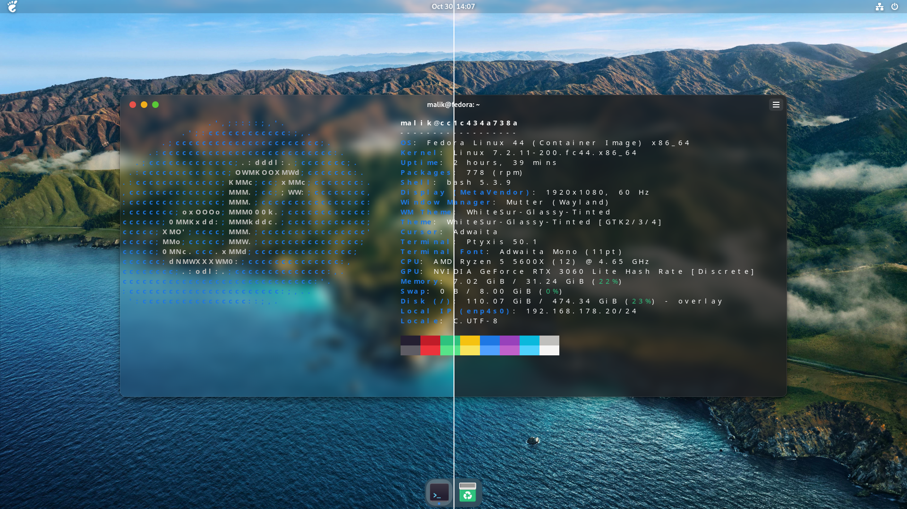

<div align="center">

# WhiteSur-Glassy

100% transparent and frosted-glass themes for GTK 3, GTK 4, Libadwaita, and GNOME Shell with Blur my Shell.

[![License][license-badge]][license]
[![GNOME Shell][gnome-badge]][gnome-link]
[![GTK][gtk-badge]][gtk-link]
[![Flatpak][flatpak-badge]][flatpak-link]

---

[Features](#features) • [Why WhiteSur-Glassy](#why-whitesur-glassy) • [Theme variants](#theme-variants) • [Install](#install) • [Supported applications](#supported-applications) • [Uninstall](#uninstall)

---

<a href="theme-slider.html">
  
</a>

<p align="center"><sub>Live full desktop capture: <b>WhiteSur-Glassy-Transparent</b> (100% clear glass, left) vs. <b>WhiteSur-Glassy-Tinted</b> (75% dark frosted glass, right) showing GNOME Shell with Blur my Shell, Dash to Dock, Logo Menu, and Ptyxis running fastfetch on macOS Big Sur backdrop. <a href="theme-slider.html">Open interactive comparison slider &rarr;</a></sub></p>

</div>

WhiteSur-Glassy is a GTK and GNOME Shell theme designed for desktop background blur. Standard GNOME applications draw solid backgrounds, and window-level opacity tools wash out text and buttons. WhiteSur-Glassy makes window container backgrounds transparent while keeping all text, icons, and interactive controls 100% opaque.

## Features

* **Two theme variants.** Choose between WhiteSur-Glassy-Transparent (100% clear background) and WhiteSur-Glassy-Tinted (75% dark frosted glass).
* **High contrast text and controls.** Text labels, icons, buttons, and text fields remain fully opaque.
* **No border outlines.** Removes button bounding boxes so controls sit naturally on glass backgrounds.
* **macOS traffic light buttons.** Left-aligned close, minimize, and maximize buttons across GTK 3, GTK 4, and Libadwaita.
* **Flatpak override support.** Automatically configures filesystem bind mounts and environment variables for Flatpak applications.
* **Terminal transparency.** Syncs terminal opacity in Ptyxis and GNOME Terminal with the chosen theme.
* **Shell configuration.** Clean `.bashrc` template with [Starship](https://starship.rs/) prompt integration and fastfetch support.
* **One-command extension setup.** Installs Blur my Shell, dynamic rounded blur, Dash to Dock, Logo Menu, and recommended presets.

## Why WhiteSur-Glassy

| Feature | Standard WhiteSur | Window Opacity Tools (e.g. Devilspie) | WhiteSur-Glassy |
| :--- | :--- | :--- | :--- |
| **Window background** | Solid grey/dark | Transparent (entire window) | Transparent or 75% tinted glass |
| **Text & icon readability** | 100% opaque | Faded & translucent | 100% opaque |
| **Buttons & inputs** | Solid grey borders | Translucent & low-contrast | Borderless, high-contrast |
| **Libadwaita apps** | Solid background | Washed out | Transparent surface |
| **Flatpak sandboxing** | Manual overrides needed | Not integrated | Automatic relative symlinks & permissions |
| **Nested opacity stacking** | N/A | Multiplies across containers | Prevented in CSS |

## Theme variants

### WhiteSur-Glassy-Transparent
Every window background, sidebar, dialog, and popover is 100% transparent. Background blur from Blur my Shell shines through with zero tint. Recommended for users who want windows to match a fully transparent terminal.

### WhiteSur-Glassy-Tinted
Applies a 75% dark translucent tint (`rgba(28, 28, 30, 0.75)`) at the root window surface. Inner views, headerbars, and containers remain transparent so opacity does not stack.

## Install

Clone the repository and run the installer:

```bash
git clone https://github.com/0xM4lik/WhiteSur-Glassy.git
cd WhiteSur-Glassy
./install.sh
```

Running without arguments opens an interactive setup that prompts for your preferred variant (Transparent or Tinted) and components.

### Non-interactive installation

Install everything and activate WhiteSur-Glassy-Transparent:

```bash
./install.sh --all --transparent
```

Install everything and activate WhiteSur-Glassy-Tinted:

```bash
./install.sh --all --tinted
```

Install only the GTK and Libadwaita themes with Flatpak support:

```bash
./install.sh --theme --transparent
```

Configure only Flatpak overrides:

```bash
./install.sh --flatpak
```

Install GNOME extensions and glassy presets:

```bash
./install.sh --extensions
```

Install WhiteSur icons:

```bash
./install.sh --icons
```

Configure terminal transparency:

```bash
./install.sh --terminal --transparent
```

Install shell configuration (.bashrc and Starship prompt):

```bash
./install.sh --shell
```

## Supported applications

| Application | Toolkit / Type | Support Status |
| :--- | :--- | :--- |
| **Files (Nautilus)** | Libadwaita / GTK 4 | Transparent grid, list view, and sidebar |
| **Text Editor** | Libadwaita / GTK 4 | Transparent editor view, gutter, and map |
| **Terminal (Ptyxis)** | Libadwaita / GTK 4 | Seamless titlebar, zero backdrop tint bug |
| **GNOME Terminal** | GTK 3 | Transparency profile configuration |
| **Calculator** | Libadwaita / GTK 4 | Transparent display and button layout |
| **Calendar** | Libadwaita / GTK 4 | Transparent month, week, and agenda views |
| **System Monitor** | GTK 3 / GTK 4 | Transparent process list and resource graphs |
| **Disks** | GTK 3 / GTK 4 | Transparent drive and partition cards |
| **Weather & Clocks** | Libadwaita / GTK 4 | Transparent forecast and alarm cards |
| **Contacts** | Libadwaita / GTK 4 | Transparent split view and contact sheets |
| **Document Viewer (Evince / Papers)** | GTK 3 / GTK 4 | Transparent sidebar and view containers |
| **Image Viewer (Loupe)** | Libadwaita / GTK 4 | Transparent canvas surface |
| **Bottles** | Libadwaita / Flatpak | Transparent bottle cards and navigation flap |
| **GNOME Tweaks** | GTK 3 | Transparent sidebar and category pages |
| **PulseAudio Volume Control (pavucontrol)** | GTK 3 | Transparent tabs and audio stream cards |
| **Archive Manager (File Roller)** | GTK 3 | Transparent treeview and archive view |
| **Disk Usage Analyzer (Baobab)** | GTK 4 | Transparent chart and ring displays |
| **Flatpak Applications** | Sandbox overrides | Global relative symlink bind mounts |

## Uninstall

Run the uninstaller to restore standard Adwaita themes, default button layouts, and reset terminal opacity:

```bash
./uninstall.sh
```

## Credits

* Based on [WhiteSur-gtk-theme](https://github.com/vinceliuice/WhiteSur-gtk-theme) and [WhiteSur-icon-theme](https://github.com/vinceliuice/WhiteSur-icon-theme) by vinceliuice.
* Background blur powered by [Blur my Shell](https://github.com/aunetx/blur-my-shell) by aunetx.
* Rounded dynamic corners powered by [gnome-rounded-blur](https://github.com/aunetx/blur-my-shell/blob/master/scripts/GUIDE.md).

[license]: LICENSE
[license-badge]: https://img.shields.io/badge/License-GPL--3.0-70a5fd?style=for-the-badge&labelColor=242426
[gnome-badge]: https://img.shields.io/badge/GNOME%20Shell-%E2%89%A545-70a5fd?style=for-the-badge&labelColor=242426
[gnome-link]: https://www.gnome.org/
[gtk-badge]: https://img.shields.io/badge/GTK-3%20%E2%80%A2%204%20%E2%80%A2%20Libadwaita-70a5fd?style=for-the-badge&labelColor=242426
[gtk-link]: https://www.gtk.org/
[flatpak-badge]: https://img.shields.io/badge/Flatpak-Supported-70a5fd?style=for-the-badge&labelColor=242426
[flatpak-link]: https://flatpak.org/
